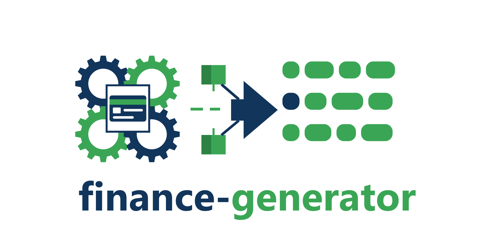

# Finance Generator for C++

> **Requires C++23** (e.g., `-std=c++23` for GCC/Clang, `/std:c++latest` for MSVC).

[](https://github.com/dasmig/finance-generator/releases)

[](https://raw.githubusercontent.com/dasmig/finance-generator/main/LICENSE.MIT)
[](https://github.com/dasmig/finance-generator/actions/workflows/ci.yml)
[](https://github.com/dasmig/finance-generator/releases)
[](https://en.cppreference.com/w/cpp/23)
[](https://github.com/dasmig/finance-generator#integration)
[](https://dasmig.github.io/finance-generator/)

**[API Reference](https://dasmig.github.io/finance-generator/)** · **[Usage Guide](doc/usage.md)** · **[Data and Method](doc/data.md)** · **[Releases](https://github.com/dasmig/finance-generator/releases)**

A person's bank accounts and payment cards, every part consistent with the person, the country and the date: IBANs and the national forms with their check digits, the country's banks and currency, and cards with the right network, length, Luhn digit and a plausible expiry.

```
DE, EUR, DE89 3704 0044 0532 0130 00, visa debit ...0016
US, USD, 110000000 000123456789, visa debit ...4242
IT, EUR, IT72 D083 9935 6065 1585 9000 748, visa debit ...0008
BR, BRL, BR35 1512 4464 0238 4535 6065 158C 1, elo debit ...1118
```

These examples use `safe`. Germany's and the US's accounts are values a sandbox publishes, Italy's and Brazil's fail a check digit, and the cards are sandbox numbers.

## Limits

- Accounts drawn without `safe`, and cards from `network_range` (the default), are structurally valid and may match a real person's account or card. The library cannot tell. A million default cards would contain real numbers: about 45 by our estimate ([why](doc/data.md#cards)).
- They are test data. Never use them for payments, direct debits, to open accounts or to pass a check, and never send them to a live payment system. Trying numbers on a live system is card testing, which is fraud, whatever produced them.
- Test numbers work only in the sandbox that published them.
- The library looks nothing up. It produces no card images, stripe data, PINs or EMV data.
- **What `safe` promises for an account varies by scheme, and for 88 countries, with 62.8% of the world's people, it promises nothing** ([which ones](doc/data.md#safe)). Their forms have no check digit and their bank lists are incomplete.

## Features

- **Accounts in Each Country's Form**. 199 countries and 21 territories: 126 IBAN formats, with national check digits such as the Bundesbank's 20 methods, and national forms such as US routing numbers, CLABE, NUBAN, CBU, New Zealand's and Brazil's and Russia's everyday ones. 40 countries have no known form and use a stand-in marked `evidence = "generic"`.

- **Real Banks**. Bank names and BICs from authorities and other lists where they exist, weighted by branches or deposits where a source gives them. 72 countries, with 18.8% of people, have no named bank.

- **Payment Cards**. The network is drawn for the country, with an expiry that fits the date and the holder's age and a holder name from the names given. There are no issuer ranges, and a Luhn-valid range number never has a security code.

- **Safe Mode**. `safe = true` applies each scheme's method: values a sandbox publishes, an unassigned bank code, or a wrong check digit. Cards take sandboxes' published numbers from Stripe, Adyen and Braintree, each with the expiry and code it states, or a wrong Luhn digit.

- **Who Holds What**. By default everything asked for is given. With `holding = surveyed`, accounts and cards follow the World Bank's Global Findex shares for the country and age.

- **Checking Text**. `is_valid(scheme, text)` checks a number's structure, every check digit and a known bank where the list is complete. `card_valid(number)` checks its length and Luhn digit, and `card_networks(number)` lists the networks whose ranges hold it.

- **Composes with the Others**. Birth dates and names are plain values, so results of [birth-generator](https://github.com/dasmig/birth-generator) and [name-generator](https://github.com/dasmig/name-generator) go straight into a request.

- **Independently Checked**. Generated accounts are read back by schwifty, python-stdnum and code written from national rules, and cards by stdnum's Luhn and the tables read separately. 89 schemes have nothing to check beyond structure. Neither library ships with this one.

- **Deterministic Seeding**. Per-call `get_finance(request, seed)` for reproducible results, and `finance::seed()` for replaying a previous generation with the same request and data.

- **Batch Generation**. Generate thousands of results from one seed, on several threads with the same output for any thread count, optionally unique by a key, and stream them as JSON Lines or CSV (see the usage guide).

- **Identical Everywhere**. A seed gives the same result on every compiler, standard library and CPU (GCC, Clang, MSVC, Emscripten; x86-64 and ARM64), checked by known-answer tests.

- **Extensible Data**. Load your own TSV layers on top of the shipped data to add, change or remove entries (`extend()`), checked before they are applied.

- **JSON and Replay**. `to_json()` on every result, and a `signature()` recording the seed and the data it came from.

- **Compiled-in Data**. Define `DASMIG_FINANCE_EMBED` to build the `lite` tier into the program, for WebAssembly and other builds without files.

- **Multi-Instance Support**. Construct independent `fng` instances with their own data and random engine.

## Integration

[`fingen.hpp`](https://github.com/dasmig/finance-generator/blob/v1-development/dasmig/fingen.hpp) is the library [released here](https://github.com/dasmig/finance-generator/releases). Keep [`core.hpp`](https://github.com/dasmig/finance-generator/blob/v1-development/dasmig/core.hpp) and the [`core/`](https://github.com/dasmig/finance-generator/tree/v1-development/dasmig/core) directory ([dasmig-core](https://github.com/dasmig/dasmig-core)) in the same directory. Add

```cpp
#include <dasmig/fingen.hpp>
```

to the files you want to use it in, and supply the [`resources`](https://github.com/dasmig/finance-generator/tree/v1-development/resources) folder (or define `DASMIG_FINANCE_EMBED`).

## Usage

```cpp
#include <dasmig/fingen.hpp>
#include <iostream>

auto& gen = dasmig::fng::instance(); // loads the lite tier

dasmig::finance_request request;
request.country = "DE";
request.cards = {dasmig::card_kind::debit};
request.safe = true;

auto v = gen.get_finance(request);
std::cout << v << '\n';           // DE, EUR, DE89 3704 0044 0532 0130 00, visa debit ...0016
std::cout << v.to_json() << '\n'; // {"country_code":"DE","birth_date":...,"accounts":[...],"cards":[...],"signature":{...}}

// The same seed gives the same result everywhere.
auto again = gen.get_finance(request, v.seed());
```

See the [usage guide](doc/usage.md) for everything else.

## Data

The structures come from SWIFT's IBAN Registry through schwifty's parsed copy, the check rules from authorities' texts where they could be read, and bank lists from central banks and open lists. Card ranges are from secondary sources, since the networks' own documents were not found, and network shares per country are judgement. [`doc/data.md`](doc/data.md) gives the source and reliability of each, the method for every scheme, and what is known to be weak, and [`LICENSE_DATA.txt`](LICENSE_DATA.txt) gives their terms.

## Building

```bash
make            # example
make test       # tests
make bench      # benchmarks, results in build/bench.tsv
make test-embed # tests with the lite tier compiled in
make coverage   # code coverage
make lint       # clang-tidy
make docs       # API docs
make embed      # regenerate dasmig/fingen_data.hpp from resources/lite
```

## Compiler Support

Tested with:
- Clang 18+ (`-std=c++23`)
- GCC 14+ (`-std=c++23`)
- MSVC 19.38+ (`/std:c++latest`)
- Emscripten 3.1.74

## Dependencies

| Dependency | Version | Bundled | Purpose |
|-----------|---------|---------|---------|
| [dasmig-core](https://github.com/dasmig/dasmig-core) | 1.4 | Yes (`core.hpp`, `core/`) | Platform-independent random engine and distributions, data layers, JSON |
| [Catch2](https://github.com/catchorg/Catch2) | 3.x | Yes (amalgamated) | Unit testing |

## Related Libraries

| Library | Description |
|---------|-------------|
| [address-generator](https://github.com/dasmig/address-generator) | Postal addresses with real streets by place |
| [biodata-generator](https://github.com/dasmig/biodata-generator) | Procedural human physical characteristics |
| [birth-generator](https://github.com/dasmig/birth-generator) | Demographically plausible birthdays |
| [city-generator](https://github.com/dasmig/city-generator) | Weighted city selection by population |
| [country-generator](https://github.com/dasmig/country-generator) | Weighted country selection by population |
| [device-generator](https://github.com/dasmig/device-generator) | Devices, browsers, user agents and IP addresses that fit together |
| [email-generator](https://github.com/dasmig/email-generator) | Email addresses in each country's style |
| [entity-generator](https://github.com/dasmig/entity-generator) | ECS-based entity generation |
| [id-generator](https://github.com/dasmig/id-generator) | National identity numbers, passports and identity cards that fit a person and a date |
| [interest-generator](https://github.com/dasmig/interest-generator) | Religion, hobbies and favourite media by country, age and sex |
| [name-generator](https://github.com/dasmig/name-generator) | Culturally appropriate full names |
| [nickname-generator](https://github.com/dasmig/nickname-generator) | Gamer-style nicknames |
| [occupation-generator](https://github.com/dasmig/occupation-generator) | Employment status, education and occupation by country, age and sex |
| [persona-generator](https://github.com/dasmig/persona-generator) | Complete characters composed from the other generators |
| [phone-generator](https://github.com/dasmig/phone-generator) | Phone numbers valid in each country's numbering plan |
| [relationship-generator](https://github.com/dasmig/relationship-generator) | Families around a person: parents, siblings, partners and children |
| [trait-generator](https://github.com/dasmig/trait-generator) | Personality traits with conflicts, synergies and Big Five axes |
| [user-generator](https://github.com/dasmig/user-generator) | Complete user records: account, username, email, phone and address |
| [vehicle-generator](https://github.com/dasmig/vehicle-generator) | Cars and motorcycles with plates and VINs that fit their country and date |
| [weather-generator](https://github.com/dasmig/weather-generator) | Daily weather for any place on land and any date |

## License

This library is released under the [MIT License](https://opensource.org/licenses/MIT).

```
MIT License

Copyright (c) 2026 Diego Dasso Migotto
```
